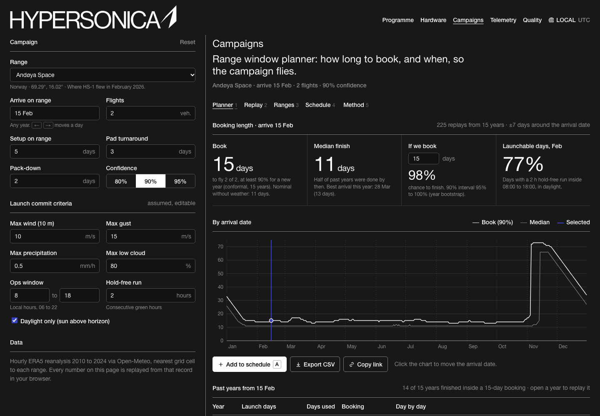

# Range window planner (concept for Hypersonica)

**Live demo:** https://mohith26.github.io/hypersonica-range-window-planner/

How many days should you book Andøya for a two-flight campaign in February, and is November ever worth it? This planner replays the campaign against 15 years of hourly weather at five ranges (Andøya, Esrange, MOD Hebrides, Churchill and Spaceport Nova Scotia), finds the booking length that finishes the campaign with a stated confidence, and backs that confidence with a hierarchical conformal bound that held up on held-out years. It also picks the arrival dates for a year of campaigns that book the fewest range days. Hypersonica's Series B is meant to "increase testing cadence", and its new Canadian entity's first priority is "expanding access to hypersonic flight testing", so range time and range choice are about to matter a lot more.

It is a planning and logistics tool only: weather, calendars and range days. It contains nothing about the vehicle, its trajectory or its performance.



*Unofficial concept demo by Mohith Gajjela. Not affiliated with Hypersonica. Public data from Open-Meteo (ERA5 / ERA5-Land reanalysis).*

## Results (default campaign, from `data/results.json`)

Default campaign: 2 flights, 5 setup days, 3-day pad turnaround, 2 pack-down days, 90% confidence. Launch commit criteria are **assumptions** (10 m wind ≤ 10 m/s, gusts ≤ 15 m/s, rain ≤ 0.5 mm/h, low cloud ≤ 80%, a 2-hour hold-free run between 08:00 and 18:00 local, sun above the horizon). Change any of them in the app and everything recomputes.

| Range | Book for arrival 15 Feb | Avg booking, held-out years | Held-out coverage (target 90%) | Season-blind booking | Season-blind worst month |
|---|---|---|---|---|---|
| Andøya Space | 15 days | 22.4 days | **95.7%** | 68 days | 79.9% |
| Esrange | 16 days | 22.3 days | 99.4% | 56 days | 78.9% |
| MOD Hebrides | 20 days | 18.7 days | 96.3% | 22 days | 93.6% |
| Churchill | 17 days | 19.4 days | 97.7% | 21 days | 90.0% |
| Spaceport Nova Scotia | 16 days | 17.6 days | 95.9% | 19 days | 92.0% |

- **Andøya, 2 flights, arriving 15 February** (when HS-1 flew): book **15 days** for 90% confidence. The weather-free minimum is 11.
- **Backtest:** calibrated on 2010-2019, tested on every arrival date in 2020-2024 (1,778 campaigns at Andøya). The per-date booking finished on time in 95.7% of them, and no arrival month fell below 89.7% (March).
- **Why per date matters:** a single booking length that hits the same target all year has to cover the polar night, so it books 68 days at Andøya and still misses 1 in 5 campaigns in its worst month. The per-date booking averages 22.4 days.
- **Year plan:** for four campaigns at least 60 days apart, the dynamic program books 54 range days at Andøya against 78 for campaigns evenly spaced from 1 January.

## How it works

1. **Launchable days.** For every day from 2010 to 2024, each hour from 06:00 to 21:00 local (DST-aware) is green when every limit holds. Daylight uses the NOAA solar-position equations. A day is launchable when it has a run of at least *r* green hours inside the ops window.
2. **Replay.** Arrive on day *D*, spend the setup days, then fly on the first launchable day; after each flight the pad needs the turnaround before the next one. Flying at the first opportunity minimises completion time (exchange argument; a randomized test checks it against brute force). Replays run for every year and for arrivals up to 7 days either side of *D*.
3. **Booking with a guarantee.** Replays from the same year share weather, so pooling them as if independent overstates confidence (a test shows the naive quantile under-covers). The booking is the hierarchical conformal threshold of Lee, Barber & Willett (2023): the smallest *t* with Σ<sub>years</sub> F<sub>year</sub>(t) / (K+1) ≥ 1−α. With years exchangeable and the arrival date drawn from the ±7-day window, a campaign in a new year finishes within the booking with probability at least 1−α. It reduces to ordinary split conformal when each year contributes one replay (tested).
4. **Year plan.** Choose *K* arrival dates at least *G* days apart within a window, minimising the sum of bookings: exact dynamic program, O(K·365), checked against brute force. With several ranges allowed, each campaign can go to whichever range is cheapest for its arrival date; since the gap constraint is on dates only, running the same DP on the per-day lower envelope is still exact (tested against brute force).
5. **Chance to finish within a booking you pick** comes with a 90% interval from a year-cluster bootstrap.

All computation runs in the browser from `src/core.js`; the same module produces `data/results.json` and runs the tests.

## The app

- **Planner** (main view): booking length, median finish, chance of finishing in a booking you type in, launchable-day rate, the booking curve across the year (click to move the date), and every past year as a day strip.
- **Replay** (drill-down): every year by day on range; click a day for its hourly wind, gust, rain, low cloud and sun elevation with the failing limit highlighted. Local or UTC.
- **Ranges:** five ranges by arrival month under the same campaign and criteria, with season-blind booking and held-out coverage; click a cell to plan it.
- **Schedule:** add windows (`A`), move them through Proposed, Requested, Confirmed, optimise a year across one or more ranges (for example Andøya plus the two Canadian sites), with dates each range is closed to you, and apply the plan. Saved in `localStorage`; export CSV or JSON.
- **Method:** the derivation and a live backtest for the current settings.
- Deep links (`#planner?site=churchill&start=06-10&flights=3`), keyboard shortcuts (`←/→`, `Shift+←/→`, `[`/`]`, `1-5`, `A`, `E`, `?`).

## Prior art and what is new

Launch-weather climatologies and day-of-launch tools exist: range weather squadrons publish probability-of-violation climatologies (for example NASA's Applied Meteorology Unit upper-level wind tool for Vandenberg), and decision-support indices exist for sounding-rocket go/no-go (Caruzzo et al., 2015/2018). Andøya Spaceport has presented its polar weather criteria (AAE, Nov 2025), and NASA's VortEx mission had two of four Andøya payloads slip from March 2023 to November 2024 because of weather. What I could not find is a campaign-level tool that turns the record into a booking length for a multi-flight campaign with pad turnaround, gives a finite-sample guarantee that respects year-to-year correlation, backtests it, and optimises a year of campaigns across candidate ranges. Hypersonica's open roles (Range Operations Manager, Launch Operations Lead, Test Range & Flight Operations Lead in Ottawa) list campaign planning around weather and go/no-go decisions as core duties, and I found no public sign of tooling for it.

## Limitations

- ERA5 is a ~30 km reanalysis: it smooths coastal gusts and has no visibility, upper-level wind, lightning or sea state. Range weather officers use local towers, soundings and forecasts on the day.
- The launch commit criteria are mine, not Hypersonica's or any range's. Replace them.
- Range availability, NOTAMs, recovery assets, hardware slips and scrubs for non-weather reasons are not modelled.
- The guarantee assumes years are exchangeable. 15 years is a short record and the climate is not stationary; the backtest is the honest check, and Andøya's 2020-2024 years were harder than its 2010-2019 years.
- The "evenly spaced" baseline for the year plan is simple; a real baseline is whatever the programme schedule says.

## Run it

```
python3 -m http.server   # then open http://localhost:8000
node --test tests/core.test.mjs
```

Rebuild the data (free Open-Meteo API, no key): `bash scripts/fetch_data.sh raw && python3 scripts/build_data.py raw data && node scripts/precompute.mjs`.

## References

- Y. Lee, R. F. Barber, R. Willett. *Distribution-free inference with hierarchical data.* arXiv:2306.06342 (2023).
- R. Dunn, L. Wasserman, A. Ramdas. *Distribution-free prediction sets for two-layer hierarchical models.* JASA 118 (2023).
- Open-Meteo Historical Weather API (ERA5, ERA5-Land; Copernicus Climate Change Service).
- NOAA Global Monitoring Laboratory, General Solar Position Calculations.
